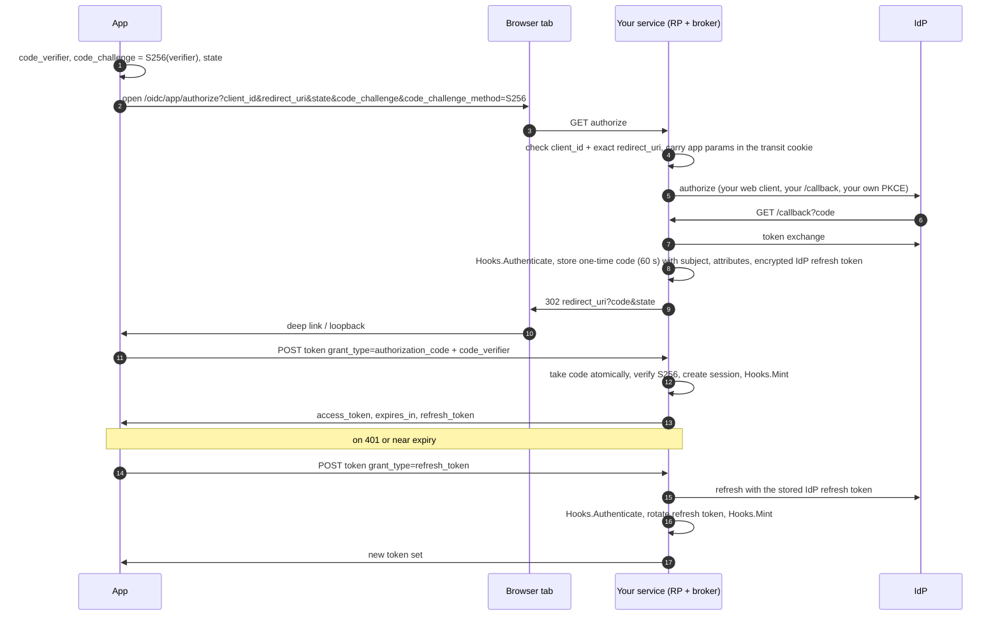

# Native apps

`oidc/native` is an opt-in broker that lets native apps (iOS, Android,
desktop, CLI) log in through your `oidc.RP`, following OAuth 2.0 for native
apps: authorization code with PKCE (RFC 6749, RFC 7636), RFC 8252
redirect URIs and RFC 7009 revocation. The app can use a stock client
library such as AppAuth, or `golang.org/x/oauth2`.

Use it when:

- the app is a **public client** (it cannot keep a secret), and
- you can't or don't want to register the app with the IdP, but your web
  RP already logs users in there. The app reuses the RP's confidential
  client and callback, and never talks to the IdP itself.

Unlike the rest of gosso, the broker is **stateful**: it stores one-time
codes and refresh sessions through `repository.Code` and
`repository.Session`, implemented on MongoDB.

## Flow



The redirect carries a one-time code, never tokens: a custom URL scheme can
be claimed by any app, and redirect URLs end up in history and logs. The
code is worthless without the `code_verifier` that only the initiating app
knows. Tokens only travel in the HTTPS response of the token endpoint.

## Wiring

The RP needs the broker's wrapped hooks, and the broker needs the RP, so
build the broker first and attach the RP last:

```go
b, err := native.New(codes, sessions, hooks, []native.Client{
    {ID: "app-ios", RedirectURIs: []string{"com.example.app:/oauth2redirect"}},
}, encryptionKey) // exactly 32 bytes
if err != nil { return err }

rp, err := oidc.New(ctx, issuer, clientID, clientSecret, callbackURL, transitKey,
    b.OnAuthenticated(webOnAuth),
    oidc.WithExtraScopes("offline_access"),
    oidc.WithOnRedirect(b.OnRedirect(webOnRedirect)), // web hook may be nil
    oidc.WithOnLoginError(b.OnLoginError(nil)),
)
if err != nil { return err }

if err := b.Attach(rp); err != nil { return err }

h := b.Handlers()
mux.Handle("/oidc/app/authorize", h.Authorize)
mux.Handle("/oidc/app/token", h.Token)
mux.Handle("/oidc/app/revoke", h.Revoke)
```

`Attach` fails unless all three wrappers were taken from the broker: a
forgotten wrapper would silently send native logins down the web path.
It only sees that the wrappers were created, not that they were passed to
`oidc.New`, so make sure they are.
Until `Attach` succeeds the handlers answer `500 server_error`.

The wrappers branch on the login context. A native login skips the web
`OnAuthenticated` (no web session cookie is set) and the web `OnRedirect`
(no web-only side effects such as a cart merge). Web logins are delegated
unchanged.

## Hooks

```go
native.Hooks{
    // Runs after a native login AND after every successful refresh.
    Authenticate: func(ctx context.Context, r *http.Request, sub sso.Subject[oidc.Payload]) (store.Attributes, error) {
        id, err := customers.Upsert(ctx, sub.ExternalID, sub.Email)
        return store.Attributes{"customerID": id}, err
    },
    // Decides the access-token format: a signed JWT, an opaque token, ...
    Mint: func(ctx context.Context, s store.Session) (native.Tokens, error) {
        jwt, err := signUserJWT(s.Subject, s.Attributes, time.Hour)
        return native.Tokens{AccessToken: jwt, ExpiresIn: time.Hour}, err
    },
}
```

- `Authenticate` returns opaque `Attributes` stored on the session and
  handed back to `Mint`. An error fails a login with
  `redirect_uri?error=server_error`, or a refresh with
  `503 temporarily_unavailable` (the session is kept).
- `Mint` gets the stored `Session` (subject projection, attributes, IDs,
  times). The broker never stores the tokens it returns.

## Endpoints

### `GET authorize`

| Parameter | |
| --- | --- |
| `client_id` | a registered client |
| `redirect_uri` | one of that client's URIs, exact string match |
| `state` | required, 1–512 printable ASCII characters except `<`, `>` and `&` |
| `code_challenge` | required, 43 base64url characters |
| `code_challenge_method` | must be `S256`; `plain` is rejected |
| `response_type` | required, must be `code` |
| `scope` | ignored |

An unknown `client_id` or `redirect_uri` is answered `400` in the browser
tab, never redirected. Every other problem redirects to the app with
`error` and `state` (`state` is left out when it was itself invalid): `invalid_request`, `unsupported_response_type`, or
after the IdP round trip `access_denied`, `login_required`,
`interaction_required`, `consent_required`, `temporarily_unavailable` (passed
through from the IdP) or `server_error` (anything else).

`code`, `state` and `error` are merged into the redirect URI's existing
query, so every legal shape works: `com.example.app:/cb`,
`com.example.app://host/cb`, `http://127.0.0.1:8090/cb`, and URIs that
already have a query.

### `POST token`

`application/x-www-form-urlencoded`, body at most 16 KiB. Public clients
send `client_id`; there is no client secret.

| `grant_type` | Parameters |
| --- | --- |
| `authorization_code` | `code`, `redirect_uri`, `client_id`, `code_verifier` |
| `refresh_token` | `refresh_token`, `client_id` |

Success (`200`):

```json
{ "access_token": "…", "token_type": "Bearer", "expires_in": 3600, "refresh_token": "<sessionID>.<secret>" }
```

Treat the refresh token as opaque. Every refresh returns a new one.

### `POST revoke`

`token=<refresh token>&client_id=…`. Ends the session (RFC 7009). The
client must identify itself: a missing or unknown `client_id` is
`400 invalid_client`, a missing `token` is `400 invalid_request`. Otherwise
always `200 {}`, including for unknown or malformed tokens and tokens of
another client.

### Errors

Token and revoke responses are JSON with `Cache-Control: no-store` and
`Pragma: no-cache`. Errors use the RFC 6749 §5.2 shape
`{"error": "…", "error_description": "…"}`.

| Situation | Result |
| --- | --- |
| unknown `client_id` / `redirect_uri` at authorize | `400`, no redirect |
| IdP error / user cancels | redirect `redirect_uri?error=access_denied&state=…` |
| `Authenticate` fails, or the IdP issued no refresh token, at login | redirect `redirect_uri?error=server_error&state=…` |
| missing or malformed parameter | `400 invalid_request` |
| unknown `client_id` at token | `400 invalid_client` |
| other `grant_type` | `400 unsupported_grant_type` |
| code unknown, expired, used; verifier, redirect or client mismatch | `400 invalid_grant` |
| refresh token unknown, malformed, other client, session expired or revoked | `400 invalid_grant`, session kept unless expired |
| refresh token reused: a rotated one presented outside the grace window | `400 invalid_grant`, session deleted |
| IdP rejects the refresh (`invalid_grant`) | `400 invalid_grant`, session deleted |
| IdP unreachable or 5xx on refresh, subject changed | `503 temporarily_unavailable`, session kept |
| `Authenticate` or `Mint` fails on refresh | `503 temporarily_unavailable`, session kept |
| the request waited 60 s in total for other refreshes of the session | `503 temporarily_unavailable` |
| repository failure | `500 server_error` |

## Lifetimes and options

| Option | Default | |
| --- | --- | --- |
| `WithCodeTTL(d)` | `60s` | how long a code can be redeemed |
| `WithSessionTTL(d)` | `90 days` | absolute session lifetime, counted from login |
| `WithRotationGrace(d)` | `10s` | how long the previous refresh tokens keep working after a rotation is stored |
| `WithDeprecatedEncryptionKeys(keys...)` | | previous 32-byte keys that still decrypt stored IdP refresh tokens |
| `WithErrorLogger(fn)` | silent | routes runtime errors to your logger |
| `WithClock(fn)` | `time.Now` | for tests |

The access-token lifetime is whatever `Mint` returns. A session also ends
when the IdP stops honouring its refresh token: each refresh redeems it, so
an account blocked or signed out at the IdP fails the next refresh with
`invalid_grant`.

## Storage

Codes and sessions are persisted through the two interfaces in
`oidc/native/repository`; the entities they store are in
`oidc/native/repository/store`:

```go
type Code interface {
    Put(ctx, c store.Code) error
    Take(ctx, hash string) (store.Code, error) // atomic find-and-delete; ErrNotFound
}

type Session interface {
    Create(ctx, s store.Session) error
    Get(ctx, id string) (store.Session, error)              // ErrNotFound
    Rotate(ctx, s store.Session, expectedHash string) error // CAS on RefreshHash; ErrConflict
    Delete(ctx, id string) error                            // idempotent
}
```

The same package implements them on MongoDB through keel's
`persistence/mongo`: `NewDefaultCode(persistor)` and
`NewDefaultSession(persistor)` use the collections `gosso_native_codes`
and `gosso_native_sessions`, each with a unique index on `id` and a TTL
index on `expiresAt`. `NewCode(collection)` and `NewSession(collection)`
take a collection you opened yourself (use `DefaultCodeIndices` /
`DefaultSessionIndices`).

```go
import "github.com/foomo/gosso/oidc/native/repository"

persistor, err := keelmongo.New(ctx, "mongodb://mongo:27017/app")
codes, err := repository.NewDefaultCode(persistor)
sessions, err := repository.NewDefaultSession(persistor)
b, err := native.New(codes, sessions, hooks, clients, encryptionKey)
```

Repositories must not filter by expiry: the broker checks `ExpiresAt`
itself, and TTL indexes are only garbage collection. Another backend only
has to implement the two interfaces.

## Security notes

- **PKCE S256 only**, `plain` is rejected; redirect URIs match exactly.
- **Codes**: 256-bit random, stored as `base64url(SHA-256)`, single use
  (atomic take), 60 s.
- **Refresh tokens**: `<128-bit session ID>.<256-bit secret>`; only the
  secret's hash is stored. Rotated on every use. Presenting a rotated
  secret outside the grace window is treated as theft (OAuth 2.0 Security
  BCP §4.14): the session is deleted. The history covers the last 32
  rotated secrets; an older one is only rejected, like a secret the session
  never issued. So knowing a session ID is not enough to end a session.
- **IdP refresh token**: AES-256-GCM encrypted, bound to the subject via
  the additional data, so a ciphertext cannot be moved to another record.
  Rotate the key by passing the new one to `New` and the old one to
  `WithDeprecatedEncryptionKeys`.
- **Login context**: the app's `state`, `redirect_uri`, `client_id` and
  `code_challenge` travel signed (not encrypted) in the transit cookie.
  None of them is secret.
- **No CSRF surface**: token and revoke are not cookie-authenticated and
  need no CORS.
- **Custom schemes** can be claimed by another app on the device. With
  PKCE that app gets a code it cannot redeem; RFC 8252 accepts this
  residual risk. Claimed HTTPS redirects (Universal Links / App Links)
  are the hardening option.

## Known limitations

- **Concurrent refreshes**: any number of refreshes with the same token
  succeed, with one IdP call. While one refresh is at the IdP the others
  wait for it; then, and for the grace window after the rotation is
  stored, they get refresh tokens of their own that are valid alongside
  the first one, so it does not matter which response the app keeps. The
  window is not extended by the duplicates. Once any of those tokens is
  refreshed, the others are rotated tokens too; using one after the next
  grace window ends the session. Serialising refreshes in the app avoids
  the question entirely.
- **Broker clocks**: a refresh holds its session for at most 60 s (30 s
  of work plus a 30 s margin), checked against the clock of whichever
  broker instance reads it. If instances sharing a database disagree by
  more than the margin, or a hook blocks long past its context, a second
  refresh can take over and call the IdP with the same IdP refresh token;
  a rotating IdP then rejects one of them and the session ends. Keep
  instance clocks in sync (NTP) and let hooks honour their context.
- **A login that outlives the transit cookie** (the user takes longer at
  the IdP than its lifetime) ends with a plain `400` from the callback:
  without the cookie there is no trusted redirect URI to send the app.
  Raise `oidc.WithTransitTTL` (default 5 min) if users need longer; the
  app should time out its own wait and offer to start the login again.
- **An IdP refresh token is required.** Request `offline_access` (or
  whatever your IdP needs to issue one). A login without one fails right
  away with `error=server_error` instead of producing a session that dies
  at its first refresh.
- **IdP-side subject changes**: a refresh whose subject differs from the
  session's answers `503` and keeps the session (with the IdP's newest
  refresh token), so every retry answers `503` until the app logs in
  again.

Whatever fails after the IdP issued a new refresh token (UserInfo,
`Authenticate`, `Mint`, a repository, the app hanging up), the broker keeps
that token and leaves the app's refresh token valid, so the app's retry
with the same refresh token works. Access tokens are minted once, after
the rotation is stored; if `Mint` fails, the rotation is taken back.
