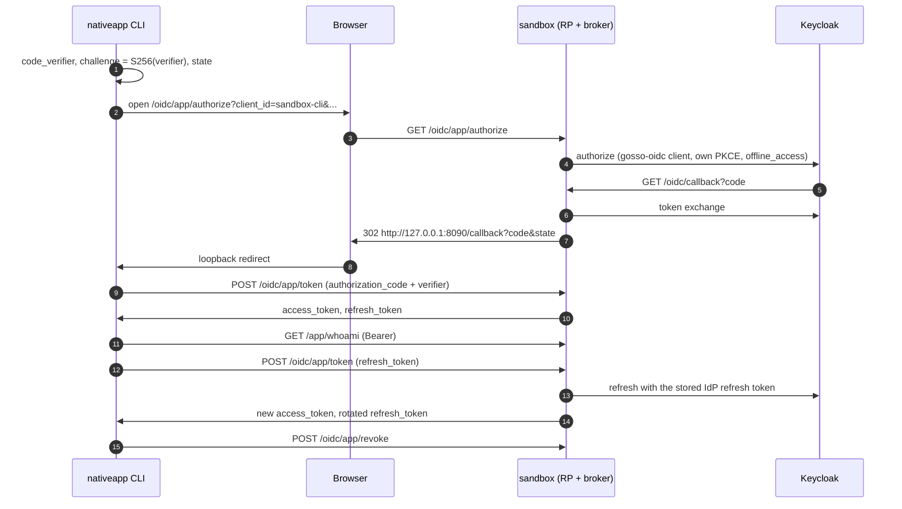

# gosso sandbox

A minimal demo that mounts both the SAML and OIDC adapters against a
local Keycloak, so you can step through a real authentication round-trip
without standing up anything yourself.

## Run it

```sh
# 1. start Keycloak (port 8081, admin / admin) and MongoDB (port 27017)
make sandbox.up

# 2. start the demo app (port 8080)
make sandbox.run
```

Open <http://localhost:8080> and click *login via SAML* or *login via
OIDC*. Log in as one of the seeded users:

| user  | password | groups  |
| ----- | -------- | ------- |
| alice | password | admins  |
| bob   | password | users   |

## Endpoints

- `/`                 landing page, login buttons / session card
- `/whoami`           JSON dump of the current session
- `/protected`        401 unless logged in
- `/saml/login`       kicks off the SAML round-trip
- `/saml/acs`         SAML assertion consumer (Keycloak posts here)
- `/saml/metadata`    SP metadata document
- `/saml/logout`      fires OnLogout + SLO redirect
- `/oidc/login`       kicks off the OIDC auth-code flow (PKCE)
- `/oidc/callback`    OIDC callback
- `/oidc/logout`      fires OnLogout + RP-initiated end-session redirect
- `/oidc/app/authorize` native broker: starts a native-app login (GET)
- `/oidc/app/token`   native broker: redeems codes and refresh tokens (POST)
- `/oidc/app/revoke`  native broker: ends a native session (POST)
- `/app/whoami`       JSON of what a native access token stands for (`Authorization: Bearer`)

## Native app flow

`../nativeapp` is a CLI public client (`sandbox-cli`) that logs in through
the native broker mounted on the OIDC RP. It uses a stock OAuth2 library
(`golang.org/x/oauth2`) and an RFC 8252 loopback redirect
(`http://127.0.0.1:8090/callback`), so it proves the endpoints speak plain
OAuth 2.0. Access tokens are opaque and live 2 minutes; the broker keeps
codes and sessions in memory.



Walkthrough, with the sandbox running (`make sandbox.up`, `make sandbox.run`):

```sh
# login, whoami, refresh, whoami, revoke; the final refresh fails with invalid_grant
make sandbox.app

# same, but replay the old refresh token after the grace window:
# reuse is detected and the whole session is revoked
make sandbox.app ARGS=-demo-reuse

# the IdP still decides: pause before the refresh, sign out alice's
# offline session in the Keycloak admin (http://localhost:8081, admin / admin,
# realm gosso-sandbox → Users → alice → Sessions), then press Enter.
# The refresh fails with invalid_grant.
make sandbox.app ARGS=-pause
```

## Tear down

```sh
make sandbox.down
```

## Files

| File                     | Purpose                                                                  |
| ------------------------ | ------------------------------------------------------------------------ |
| `docker-compose.yaml`    | Keycloak container (imports the realm JSON on first boot) and MongoDB for the native broker. |
| `realm-export.json`      | Pre-provisioned realm (users, groups, SAML + OIDC clients).              |
| `certs/sp.{crt,key}`     | Dev-only SP cert. Do **not** use outside this sandbox. Regenerate with `make sandbox.certs`. |
| `main.go`                | The demo app: in-memory session, both protocols and the native broker mounted. |
| `../nativeapp/main.go`   | Native-app CLI client for the broker (loopback redirect, PKCE).          |

## How to break it (educational)

- Edit `realm-export.json`, e.g. disable the `groups` protocol mapper
  on the SAML client, and watch `sub.Groups` become empty on the
  `/whoami` endpoint.
- Swap `oidc.WithUserInfo(true)` in `main.go` on/off and see the effect
  on which claims populate `Subject`.
- Change the SAML attribute URIs in `saml.WithAttributeMap(...)` to
  something Keycloak isn't emitting, and watch `Subject` fields go
  blank.
