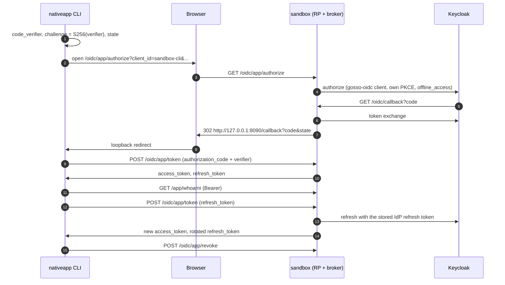

# gosso sandbox

A minimal demo that mounts both the SAML and OIDC adapters against a
local Keycloak, so you can step through a real authentication round-trip
without standing up anything yourself.

## Run it

```sh
# 1. start Keycloak (port 8081, admin / admin) and MongoDB (port 27017)
make sandbox.up

# 2. start the demo app (port 8080)
make sandbox.run
```

Open <http://localhost:8080> and click *login via SAML* or *login via
OIDC*. Log in as one of the seeded users:

| user  | password | groups  |
| ----- | -------- | ------- |
| alice | password | admins  |
| bob   | password | users   |

## Endpoints

- `/`                 landing page, login buttons / session card
- `/whoami`           JSON dump of the current session
- `/protected`        401 unless logged in
- `/saml/login`       kicks off the SAML round-trip
- `/saml/acs`         SAML assertion consumer (Keycloak posts here)
- `/saml/metadata`    SP metadata document
- `/saml/logout`      fires OnLogout + SLO redirect
- `/oidc/login`       kicks off the OIDC auth-code flow (PKCE)
- `/oidc/callback`    OIDC callback
- `/oidc/logout`      fires OnLogout + RP-initiated end-session redirect
- `/oidc/app/authorize` native broker: starts a native-app login (GET)
- `/oidc/app/token`   native broker: redeems codes and refresh tokens (POST)
- `/oidc/app/revoke`  native broker: ends a native session (POST)
- `/app/whoami`       JSON of what a native access token stands for (`Authorization: Bearer`)

## Native app flow

`../nativeapp` is a CLI public client (`sandbox-cli`) that logs in through
the native broker mounted on the OIDC RP. It uses a stock OAuth2 library
(`golang.org/x/oauth2`) and an RFC 8252 loopback redirect
(`http://127.0.0.1:8090/callback`), so it proves the endpoints speak plain
OAuth 2.0. Access tokens are opaque and live 2 minutes; the broker keeps
codes and sessions in MongoDB (`gosso_sandbox` database).



## Testing the native broker

Every step is a make target. Each `sandbox.app*` scenario checks its own
expected outcome, prints `PASS` or `FAIL` and exits non-zero on failure.
Scenarios that log in open the authorize URL in your browser (or print
it); log in as `alice` / `password`.

### 1. Start

```sh
make sandbox.down     # optional: clean slate, drops keycloak + mongo volumes
make sandbox.up       # keycloak :8081 + mongo :27017, returns once both are healthy
make sandbox.status   # both containers "(healthy)"
make sandbox.run      # demo app on :8080; keep this terminal open
```

Broker failures are logged in the `sandbox.run` terminal as
`gosso error stage=native-…`; `make sandbox.logs ARGS=keycloak` follows
Keycloak.

### 2. Web flows still work

Open <http://localhost:8080>, log in via OIDC and via SAML, log out. This
is the regression check for the `oidc` changes the broker relies on.

### 3. Protocol checks (no login)

```sh
make sandbox.app.check
```

15 checks: authorize validation (unknown client and redirect URI answered
`400` without redirect; `plain` PKCE, malformed challenge, hostile `state`
and `response_type=token` redirected to the app with an error), token and
revoke error codes and `no-store` headers, and `401 invalid_token` on
`/app/whoami` without a bearer token.

### 4. Scenarios

| Target | What it proves |
| --- | --- |
| `make sandbox.app` | login, whoami, refresh (token rotates), whoami, revoke; refresh after revoke → `invalid_grant` |
| `make sandbox.app.reuse` | replaying an old refresh token after the 10 s grace window → `invalid_grant`, and the current token is dead too (session revoked) |
| `make sandbox.app.concurrent` | two refreshes with the same token at once both succeed (one Keycloak call); the token from the response that finished last still works after the grace window |
| `make sandbox.app.outage` | interactive: run `make sandbox.idp.stop` when asked → refresh answers `503 temporarily_unavailable`; run `make sandbox.idp.start` → the **same** refresh token works again |
| `make sandbox.app.signout` | interactive: run `make sandbox.idp.signout` when asked (revokes alice's offline token at Keycloak) → refresh → `invalid_grant` |

`make sandbox.idp.signout` honours `SANDBOX_USER=bob` if you log in as
bob.

### 5. Look at the stored state

```sh
make sandbox.mongo
```

Prints the number of codes and sessions, the sessions (subject,
attributes, timestamps, encryption key ID; refresh secrets are only ever
stored hashed and the IdP token only encrypted) and the indexes,
including the TTL index on `expiresAt`. Run it while
`make sandbox.app.outage` waits at a prompt to see a live session.

### 6. Restart survives

```sh
make sandbox.app.restart
```

When asked, restart `make sandbox.run` (Ctrl-C, start it again), then
press Enter: the refresh succeeds, because sessions live in MongoDB. Only
the sandbox's own 2-minute access tokens are in memory and are gone after
the restart.

## Tear down

```sh
make sandbox.down
```

## Files

| File                     | Purpose                                                                  |
| ------------------------ | ------------------------------------------------------------------------ |
| `docker-compose.yaml`    | Keycloak container (imports the realm JSON on first boot) and MongoDB for the native broker. |
| `realm-export.json`      | Pre-provisioned realm (users, groups, SAML + OIDC clients).              |
| `certs/sp.{crt,key}`     | Dev-only SP cert. Do **not** use outside this sandbox. Regenerate with `make sandbox.certs`. |
| `main.go`                | The demo app: in-memory session, both protocols and the native broker mounted. |
| `../nativeapp/main.go`   | Native-app CLI client for the broker (loopback redirect, PKCE).          |

## How to break it (educational)

- Edit `realm-export.json`, e.g. disable the `groups` protocol mapper
  on the SAML client, and watch `sub.Groups` become empty on the
  `/whoami` endpoint.
- Swap `oidc.WithUserInfo(true)` in `main.go` on/off and see the effect
  on which claims populate `Subject`.
- Change the SAML attribute URIs in `saml.WithAttributeMap(...)` to
  something Keycloak isn't emitting, and watch `Subject` fields go
  blank.
